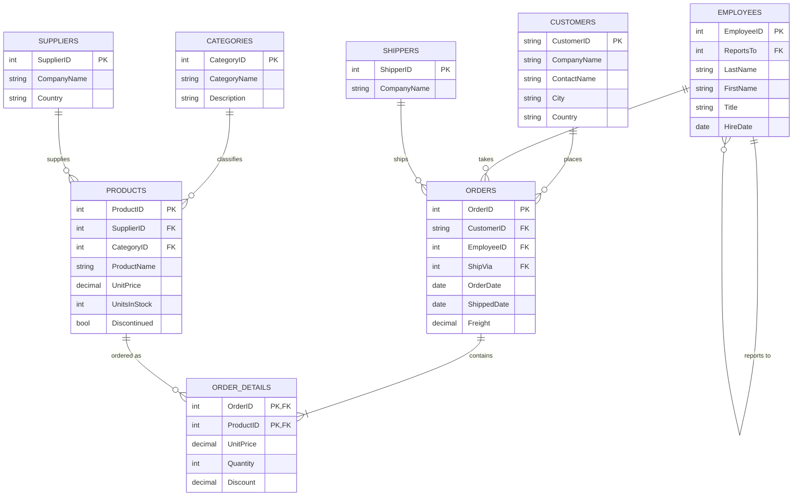

# Northwind Data Schema

Extracted from `Northwind.MDB` into CSV files. One CSV per table; relations below follow the original Access foreign keys.

## Entity Relationship Diagram



## Tables

| CSV | Rows | Primary key | Description |
|---|---|---|---|
| `Orders.csv` | 830 | `OrderID` | Order header: customer, employee, shipper, dates, freight, ship-to address |
| `Order_Details.csv` | 2,155 | `OrderID` + `ProductID` | Order line items (facts) |
| `Products.csv` | 77 | `ProductID` | Product catalog with pricing and stock |
| `Customers.csv` | 91 | `CustomerID` | Customer master |
| `Employees.csv` | 9 | `EmployeeID` | Sales staff |
| `Categories.csv` | 8 | `CategoryID` | Product categories |
| `Shippers.csv` | 3 | `ShipperID` | Shipping companies |
| `Suppliers.csv` | 29 | `SupplierID` | Product suppliers |

## Relations

| From (many) | Foreign key | To (one) | Primary key |
|---|---|---|---|
| `Orders` | `CustomerID` | `Customers` | `CustomerID` |
| `Orders` | `EmployeeID` | `Employees` | `EmployeeID` |
| `Orders` | `ShipVia` | `Shippers` | `ShipperID` |
| `Order_Details` | `OrderID` | `Orders` | `OrderID` |
| `Order_Details` | `ProductID` | `Products` | `ProductID` |
| `Products` | `CategoryID` | `Categories` | `CategoryID` |
| `Products` | `SupplierID` | `Suppliers` | `SupplierID` |
| `Employees` | `ReportsTo` | `Employees` | `EmployeeID` (self-reference) |

## Business logic

- **Line revenue** = `Order_Details.UnitPrice * Quantity * (1 - Discount)`
- `Orders` also carries denormalized ship-to fields (`ShipName`, `ShipAddress`, `ShipCity`, `ShipRegion`, `ShipPostalCode`, `ShipCountry`) copied per order.
- OLE blob columns (`Photo` in Employees, `Picture` in Categories) were dropped during extraction.
- `Orders.Freight` was rescaled from raw JET currency (×10000) to dollars.

## Example join

Revenue by category:

```sql
SELECT c.CategoryName,
       SUM(od.UnitPrice * od.Quantity * (1 - od.Discount)) AS revenue
FROM Order_Details od
JOIN Products    p USING (ProductID)
JOIN Categories  c USING (CategoryID)
GROUP BY c.CategoryName
ORDER BY revenue DESC;
```
